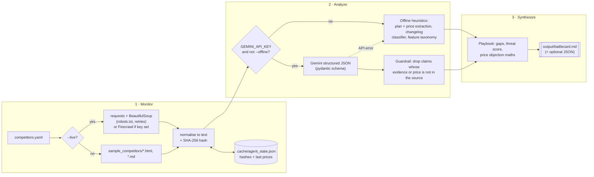

<h1 align="center">⚔️ battlecard-ai</h1>

<p align="center"><i>Automated B2B competitive intelligence &amp; GTM agent</i></p>

<p align="center">
  <a href="https://github.com/Creator-hub24/battlecard-ai/actions/workflows/tests.yml"></a>
  
  
  
  
</p>

<p align="center"><b>An agent that watches competitor pricing pages and changelogs, works out what changed, and writes the Sales Battlecard a PMM would otherwise build by hand every month.</b></p>

> ⚠️ **Honest note: the competitors are fictional.** Sumzilla, Ganitron Live and NumeroNest AI are **invented companies** with invented prices and changelogs (all marked `mock: true`, all on `.example` domains). They exist so the demo runs end to end without scraping or misquoting a real business. "Us" is an illustrative Edumaths360-style Class 6-10 maths platform. Point `competitors.yaml` at real URLs with `--live` to use it for real.

## 💼 The business problem

In B2B and B2B2C SaaS, competitive intel goes stale fast. A rival cuts prices before the festive season, ships an AI feature, or quietly removes something from its free plan, and the sales team finds out on a call when the buyer says *"but X is cheaper"*.

Product marketing usually fixes this by hand: check five pricing pages and changelogs, update a spreadsheet, rewrite the battlecard, post it in Slack. It is slow, so it happens quarterly, so the card is always out of date.

This agent does that loop automatically:

| PMM task | What the agent does |
|---|---|
| "Did anything change?" | Hashes every page and diffs prices against the last snapshot. New, changed and unchanged sources are flagged. |
| "What does it mean?" | Classifies dated changelog entries (pricing, launch, removal, known issue) and maps features to a fixed taxonomy. |
| "What do reps say?" | Writes landmine questions, objection handling (including **"Competitor X is cheaper"** with like-for-like maths) and win themes. |
| "Can I trust it?" | Every claim cites a source file or URL with a retrieval timestamp. LLM output is fact-checked against the source text. |

## 🏗️ Architecture



## 🚀 Quickstart

```bash
git clone https://github.com/Creator-hub24/battlecard-ai.git
cd battlecard-ai
python -m venv .venv && source .venv/bin/activate
pip install -r requirements.txt

# Fully offline: local mock pages + heuristic analyzer. No keys, no network.
python agent.py --offline --out output/battlecard.md

# One competitor, plus a JSON dump of the analysis
python agent.py --offline --competitor sumzilla --json output/sumzilla.json

# Gemini analysis (copy .env.example to .env and set GEMINI_API_KEY)
python agent.py --out output/battlecard.md

# Real URLs from competitors.yaml (respects robots.txt; uses Firecrawl if FIRECRAWL_API_KEY is set)
python agent.py --live --out output/battlecard.md

# Scheduled use: skip rewriting the card when no source changed since the last run
python agent.py --changed-only

pytest -q
```

All options: `python agent.py --help` (`--config`, `--competitor`, `--out`, `--json`, `--offline`, `--live`, `--as-of`, `--lookback-days`, `--no-cache`, `--changed-only`, `-v`).

## 📄 What the battlecard looks like

The full sample is in [`output/sample_battlecard.md`](output/sample_battlecard.md). It was **generated by running the agent, not written by hand**:

```bash
python agent.py --offline --no-cache --out output/sample_battlecard.md
```

It was produced in **offline mode** (heuristic analyzer, no LLM), so anyone can reproduce it without an API key. A test (`test_committed_sample_battlecard_matches_agent_output`) re-runs the agent and fails if the committed file drifts from real output. The change window is pinned with `as_of: 2026-10-29` in `competitors.yaml` so the output is reproducible.

Each card has: Executive TL;DR → What changed → Pricing comparison → Feature matrix → Weak points → Landmine questions → Objection handling → Win themes → Sources (with SHA-256 and retrieval time in IST).

**Excerpt: Executive TL;DR**

| Competitor | Threat | Positioning | Biggest recent move | How we win |
|---|---|---|---|---|
| **Sumzilla** | 🔴 High | Budget player (₹167-₹249/month); leads with offline / low-data access, gamified streaks and leaderboards, step-by-step worked solutions. | Sumzilla Plus: ₹349 → ₹249/month (2026-10-05) | Board-pattern mocks with marking-scheme feedback |
| **Ganitron Live** | 🟠 Medium | Premium player (₹1,500-₹4,999/month); leads with live classes, Hindi / bilingual content, doubt solving. | Live Batch Annual: ₹14,999 → ₹17,999/year (2026-10-01) | Board-pattern mocks with marking-scheme feedback |
| **NumeroNest AI** | 🟠 Medium | Similar-priced player (₹400-₹599/month); leads with gamified streaks and leaderboards, adaptive practice (difficulty adjusts per student), step-by-step worked solutions. | Nest Pro: ₹499 → ₹599/month (2026-09-28) | Board-pattern mocks with marking-scheme feedback |

**Excerpt: the price objection, with like-for-like maths**

**"Sumzilla is cheaper."**
> On sticker price, yes: Sumzilla starts at ₹167/month (Sumzilla Plus Annual) vs our ₹333/month (Pro Annual). But compare like for like: Sumzilla Plus plus AI Doubt Bot add-on (beta) costs ₹348/month, against ₹499/month for our Pro Monthly with everything included. What the lower price does not include: adaptive practice (difficulty adjusts per student); full-length board-pattern mock tests; chapter-wise weakness report. Their current price is a promotional offer that may be revised. Reframe to cost per mark gained: one board-pattern mock with a weakness report is worth more than a month of unlimited easy questions.

**Excerpt: feature matrix vs NumeroNest AI**

| Capability | Edumaths360 | NumeroNest AI | Evidence (NumeroNest AI) |
|---|---|---|---|
| Adaptive practice (difficulty adjusts per student) | ✅ Yes | ✅ Yes | Adaptive practice that adjusts difficulty to your child |
| Full-length board-pattern mock tests | ✅ Yes | ❌ No | Full-length board mock tests are not available yet. |
| Chapter-wise weakness report | ✅ Yes | ➖ Not mentioned | - |
| Covers the full Class 6-10 syllabus | ✅ Yes | 🟡 Partial | Currently for Class 6-8 only. |
| Gamified streaks and leaderboards | 🟡 Partial | ✅ Yes | XP streaks |

## 🤖 Gemini mode and the guardrail

When `GEMINI_API_KEY` is set (and `--offline` is not), each competitor's normalised pages go to Gemini (`gemini-flash-latest` by default; override with `GEMINI_MODEL`) through the `google-genai` SDK. The request uses `response_mime_type="application/json"` with a **pydantic `response_schema`**, so the reply is parsed and validated, not regex-scraped.

LLMs invent things, and a battlecard with a made-up price is worse than no battlecard. So the agent does not trust the reply:

- **Evidence must be in the source.** Every change, feature status and weak point must quote evidence that appears verbatim (or near-verbatim, ≥85% fuzzy match) in the fetched text. Anything else is dropped.
- **Prices must be in the source.** A price shift is kept only if both prices appear on the page or changelog.
- **Plan prices are never taken from the LLM.** The pricing table always comes from deterministic extraction.
- **Dropped claims are counted** and shown on the card (`Guardrail: N ungrounded claim(s) dropped`).
- **Fallback:** if the Gemini call fails (quota, timeout, bad JSON), that competitor is analyzed offline and the card says so.

## 🗂️ Repository structure

```
battlecard-ai/
├── agent.py                    # the agent: Monitor → Analyze → Synthesize CLI
├── competitors.yaml            # who to watch, sources, feature taxonomy + landmine questions
├── sample_competitors/         # MOCK data (fictional companies)
│   ├── README.md
│   ├── edumaths360/profile.yaml    # "us": plans, features, differentiators, counter-positioning
│   ├── sumzilla/               # budget, gamified   (pricing.html, pricing_2026-06.html, changelog.md)
│   ├── ganitron/               # premium live classes (pricing.html, pricing_2026-06.html, changelog.html)
│   └── numeronest/             # freemium AI tutor   (pricing.html, pricing_2026-06.html, changelog.md)
├── output/sample_battlecard.md # generated by the agent (offline mode)
├── tests/test_agent.py         # offline tests, incl. a fake Gemini client
├── .github/workflows/tests.yml # pytest on Python 3.11-3.13 + an offline smoke run
├── pyproject.toml              # package metadata (battlecard-ai)
├── requirements.txt
├── .env.example
└── LICENSE
```

To add a competitor, add an entry to `competitors.yaml` with a `pricing` and `changelog` source (`url` for `--live`, `local` for offline, optional `baseline` for the previous snapshot). To change what "a feature" means, edit the `features` taxonomy: keywords, partial keywords and the landmine question for each.

## 🛠️ Tech stack

Python 3.11+ · requests · BeautifulSoup4 · Firecrawl (optional) · google-genai (Gemini, optional) · pydantic v2 · PyYAML · pytest · GitHub Actions

## 🧪 Tests

`pytest -q` runs the full suite with no network and no API keys: HTML normalisation, price and plan extraction, date formats, changelog classification, feature statuses (yes / partial / no / not mentioned), price diffs, the change-detection cache (new → unchanged → changed), the Firecrawl request shape, the Gemini guardrail with a fake client (drops an invented launch and an invented price), fallback when Gemini errors, CLI errors, and an end-to-end run.

## 🗺️ Roadmap

- **Delivery:** post the TL;DR to a Slack channel and push the full card to a Notion page when something changes.
- **Scheduling:** a nightly cron / GitHub Actions `schedule:` job running `--live --changed-only`.
- **More sources:** G2/Capterra reviews, app-store release notes, job posts (as a hint about roadmap) and LinkedIn launch posts.
- **History:** keep every snapshot to chart price moves over time.
- **Win/loss loop:** feed CRM loss reasons back in to rank which objections matter most.

## 🎥 Video walkthrough

Loom demo: coming soon.

## 👤 Author

**Vaibhav Gupta**, founder of Edumaths360 and maths teacher (Class 6–10), previously taught CAT/CLAT at Career Launcher for 6 years. This repo is part of a portfolio for product marketing and GTM roles: it shows how I would turn competitor noise into something a sales team can use on its next call. 📧 [Edumaths360@gmail.com](mailto:Edumaths360@gmail.com)

Licensed under the [MIT License](LICENSE).
